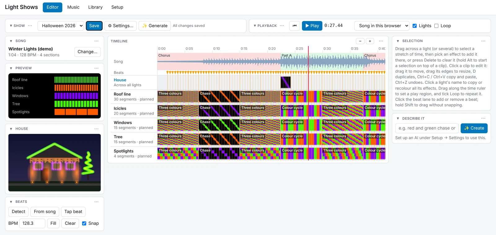
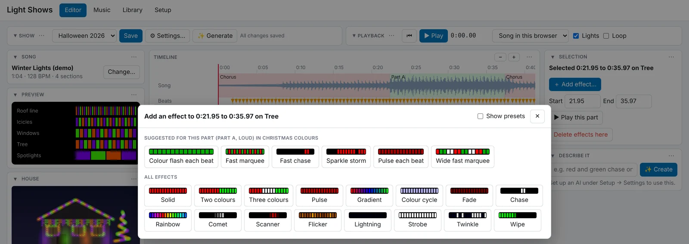
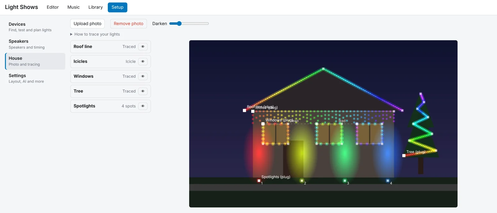
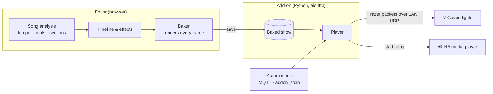

<div align="center">

# 🎄 Govee HA Show

**Music-synchronised light shows for Govee lights, built right inside Home Assistant.**

A simple alternative to xLights, made for Govee: design a show in your browser, watch it play on a
photo of your house, then run it from an automation. No extra software, no separate server.

[](https://github.com/gavin-vbmedia/govee-ha-show/actions/workflows/ci.yml)
[](govee_show/CHANGELOG.md)

[](LICENSE)

[](https://my.home-assistant.io/redirect/supervisor_add_addon_repository/?repository_url=https%3A%2F%2Fgithub.com%2Fgavin-vbmedia%2Fgovee-ha-show)

[Install](#-installation) · [Features](#-features) · [User guide](govee_show/DOCS.md) ·
[Changelog](govee_show/CHANGELOG.md) · [Development](#-development)



</div>

## ✨ Highlights

- 🎵 **Hears the song for you.** Tempo, beats, bars and sections (intro, verse, chorus…) are detected
  in your browser, and every effect snaps to them.
- 🪄 **A first draft in one click.** **Generate** fills every light with effects that follow the
  music, in the palette and style you pick, ready for you to tweak.
- 💬 **Or just describe it.** "Red and green chase on the roof in every chorus" and an AI adds it,
  using Claude or any AI you've set up in Home Assistant, local models included.
- 🏠 **See it on your house.** Trace your lights on a photo and the editor plays the show there,
  bulb by bulb, so you can design without standing in the garden.
- 📦 **Plan before you buy.** Add lights that haven't arrived yet and link them to the real ones later.
- ⏯️ **Runs itself.** Shows play on any Home Assistant speaker and start from automations through MQTT
  entities or the `hassio.addon_stdin` action.

## 📸 A closer look

<table>
  <tr>
    <td width="50%"></td>
    <td width="50%"></td>
  </tr>
  <tr>
    <td><b>Pick an effect.</b> Suggestions fit the part of the song you selected, and every button
    previews the effect on that light.</td>
    <td><b>Trace your house.</b> Lines, icicles and spotlights, each drawn bulb by bulb from the plug
    end.</td>
  </tr>
</table>

## 🚀 Installation

**Requires** Home Assistant OS or Supervised, and Govee lights with **LAN Control** turned on in the
Govee Home app.

1. Press **Add repository** above. It opens your Home Assistant and offers to add this add-on
   repository.
   <details><summary>Adding it by hand</summary>

   Go to **Settings → Add-ons → Add-on Store**, open the ⋮ menu, choose **Repositories** and add
   `https://github.com/gavin-vbmedia/govee-ha-show`.
   </details>
2. Install **Govee Light Show**, turn on **Show in sidebar**, and start it.
3. Open **Light Shows** from the sidebar and follow the
   [quick start](govee_show/DOCS.md#quick-start).

Home Assistant builds the add-on on your machine the first time, which takes a few minutes. For show
entities in automations, also set up the Mosquitto broker add-on and the MQTT integration (optional).

## 🧰 Features

<details open>
<summary><b>💡 Lights</b></summary>

- Discover Govee devices on the local network, check each one's segments with a test pattern,
  and set its segments, bulb count, brightness, direction and blending
- Plan shows before your lights arrive: add planned lights by name and segment count, then link
  them to the real devices later
- Put your lights in any order (drag them on the Devices tab) and every show's timeline follows
- Split a light into parts (say, the front, side and back of a roof line) that each get their own
  track, while the light's own track still plays across all of them as one; segments in no part
  stay off during the show. **Test** a part to see exactly where it starts and ends on the real light
- Per-bulb colour for lights whose realtime mode only reaches part of them, such as the Christmas
  String Lights 2 and icicle lights (experimental), using the Govee app's own Finger sketch pictures

</details>

<details open>
<summary><b>🏠 Your house</b></summary>

- See the show on a photo of your house: trace where each light runs and the editor plays it there,
  bulb by bulb
- Draw icicle lights as hanging drops and spotlights as beams aimed at the wall
- Mark stretches that run out of view (round a corner, or an extension lead) so the bulb count
  still lines up; those bulbs still play in the real show
- Pin segments to where they really are when the photo is taken at an angle
- A sidebar lists every light so houses with many lights stay manageable

</details>

<details open>
<summary><b>🎬 Building a show</b></summary>

- Detect the song's tempo, beats, bars and sections automatically, in the browser
- Generate a first draft of a whole show from the song in one click, in a palette and style you pick
- Describe effects in words and an AI adds them, using Claude with your API key or any AI set up in
  Home Assistant, including local ones
- Effect suggestions for the selected part of the song, timed to its tempo
- Timeline editor with the song's waveform, one track per light, beat markers and snapping, and
  smooth zoom (+/−, Ctrl+wheel or pinch) and scroll
- 15 effects on each light (solid, two and three colours, pulse, gradient, colour cycle, fade, chase,
  rainbow, comet, scanner, flicker, lightning, strobe, twinkle, wipe) with live, segment-level
  previews, built-in presets for each, and your own presets saved from any clip
- A **House** lane for effects that run across all your lights by where they are on the photo, like
  xLights' model effects: sweeps, wipes and rainbow waves in any direction
- Colour palettes for holidays and moods, plus your own, to recolour an effect, a light or the
  whole show in one click
- Copy and paste effects between lights, play and loop just a region, undo and redo
- Knows what each light can show: effects that won't work on a light (a chase on a light that shows one
  colour at a time) are greyed out in the chooser, such clips in older shows are marked on the timeline,
  and previews step at a slow light's own pace so they look like the real thing
- Cut, trim and splice songs on the **Music** tab, with crossfades
- Arrange the editor your way: pick a page layout, then drag, collapse or hide any panel
- Experimental: hand a light to one of Govee's built-in scenes for part of the show

</details>

<details open>
<summary><b>▶️ Playing it</b></summary>

- Save and load shows, with auto save; each show is baked into precomputed frames for reliable playback
- Play the song on any Home Assistant media player (with a per-speaker delay), or in the browser
- Schedule or trigger shows from automations: MQTT entities (show select, play/stop buttons,
  status), or the `hassio.addon_stdin` action

</details>

The full walkthrough is in the **[user guide](govee_show/DOCS.md)**, which is also on the add-on's
Documentation tab in Home Assistant.

## ⚙️ How it works



One Python service (aiohttp) serves the editor through Home Assistant ingress and plays shows.
Effects are written once, in JavaScript: the editor uses them for the live preview and, on save,
renders every frame of the show into a compact baked file. The player only streams those frames to
each device over Govee's undocumented per-segment "razer" LAN protocol, with rate limiting,
keepalive and periodic re-enable. It follows either the browser's audio position or, for a Home
Assistant speaker, starts the lights when the speaker reports it is playing (plus that speaker's
delay) and corrects large drift from its reported position.

## 🛠️ Development

```sh
pip install -r govee_show/requirements.txt pytest pytest-aiohttp
python -m pytest
node --test tests/js/*.mjs
```

Run the service locally (requests from this machine are allowed without ingress):

```sh
cd govee_show/app
GOVEE_SHOW_CONFIG=/tmp/gs/config GOVEE_SHOW_MEDIA=/tmp/gs/media python -m goveeshow
# then open http://localhost:8099/ (GOVEE_SHOW_PORT changes the port)
# Optional: HA_URL=http://homeassistant.local:8123 HA_TOKEN=<long-lived token> to use real speakers
```

No lights to hand? Add planned lights on **Setup → Devices** and everything except the real output
works. To try it in Home Assistant, copy the `govee_show` folder into `/addons` (Samba or SSH add-on),
then reload the Add-on Store; it appears under **Local add-ons** and builds on your machine.

**Releasing:** bump the version in `pyproject.toml`, `govee_show/config.yaml` and
`govee_show/app/goveeshow/__init__.py` together (CI checks they match), and add an entry to
[`CHANGELOG.md`](govee_show/CHANGELOG.md).

<details>
<summary><b>Repository layout</b></summary>

```
repository.yaml                         Home Assistant add-on repository metadata
docs/images/                            Screenshots for the README
govee_show/                             The add-on (config, Dockerfile, docs, changelog)
  README.md                             Intro shown on the add-on's Info tab
  DOCS.md                               User guide (shown on the add-on's Documentation tab)
  CHANGELOG.md                          What changed in each version
  icon.png, logo.png                    Pictures shown in the Add-on Store
  app/goveeshow/__main__.py             Entry point and environment settings
  app/goveeshow/protocol.py             Govee LAN and razer packet encoding
  app/goveeshow/discovery.py            Multicast device scan
  app/goveeshow/listen.py               Records other Govee traffic (Settings → Listen)
  app/goveeshow/lab.py                  Packet lab: hand-made messages to one light
  app/goveeshow/output.py               Per-device streaming, keepalive, test pattern
  app/goveeshow/baked.py                Baked show file format
  app/goveeshow/player.py               Plays baked frames against a movable clock
  app/goveeshow/runner.py               Starts shows on a speaker or for the browser
  app/goveeshow/scenes.py               Govee scene library lookup (experimental scenes)
  app/goveeshow/storage.py              Shows, settings, songs and the house photo on disk
  app/goveeshow/ha.py                   Home Assistant API (media players, MQTT details)
  app/goveeshow/commands.py             Automation commands over add-on stdin
  app/goveeshow/mqtt.py                 MQTT discovery entities
  app/goveeshow/server.py               HTTP API for the editor
  app/goveeshow/ai.py                   Describe it and AI presets: asks Claude or HA's AI Task
  app/goveeshow/static/                 The editor (plain ES modules, no build step)
    index.html, style.css               Page and styles
    js/app.js                           Editor state, panels, inspector and playback
    js/effects.js                       Effect definitions, House lane effects and the baker
    js/timeline.js                      Timeline canvas: waveform, clips, selection, zoom
    js/house.js                         House photo: tracing, bulb layout, icicles, spots
    js/devicetest.js                    Frames for testing a light's parts on the Devices tab
    js/labtemplates.js                  Packet lab starting points
    js/layout.js                        Movable panel layout
    js/palettes.js                      Colour palette presets
    js/music.js                         Music tab: cutting, trimming and splicing songs
    js/analysis.js                      Song analysis: tempo, beats, bars and sections
    js/analysis-worker.js               Runs the analysis off the main thread
    js/autogen.js                       Generates a draft show from the analysis
    js/lightspeed.js                    How fast each protocol can change a light, and previews at that pace
    js/compat.js                        Whether a clip's effect can show on its light, for marking and blocking
    js/aiclips.js                       Describe it: context for the AI, checking its clips and presets
    models.json                         Our list of Govee lights: tested status and default settings
tools/build_models.py                   Adds new Govee lights to models.json, by name
tools/govee_btsnoop.py                  Decrypts the Govee app's Bluetooth traffic from an Android log
docs/govee-protocols.md                 How Govee lights are driven: findings, measurements, open questions
tests/                                  pytest and node tests (tests/js)
```

</details>

## 📄 Licence

MIT, see [LICENSE](LICENSE). Not affiliated with Govee or Home Assistant.
